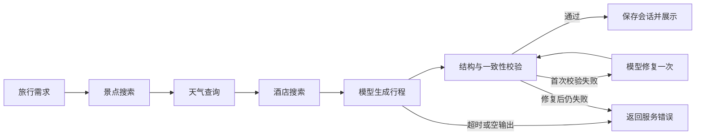
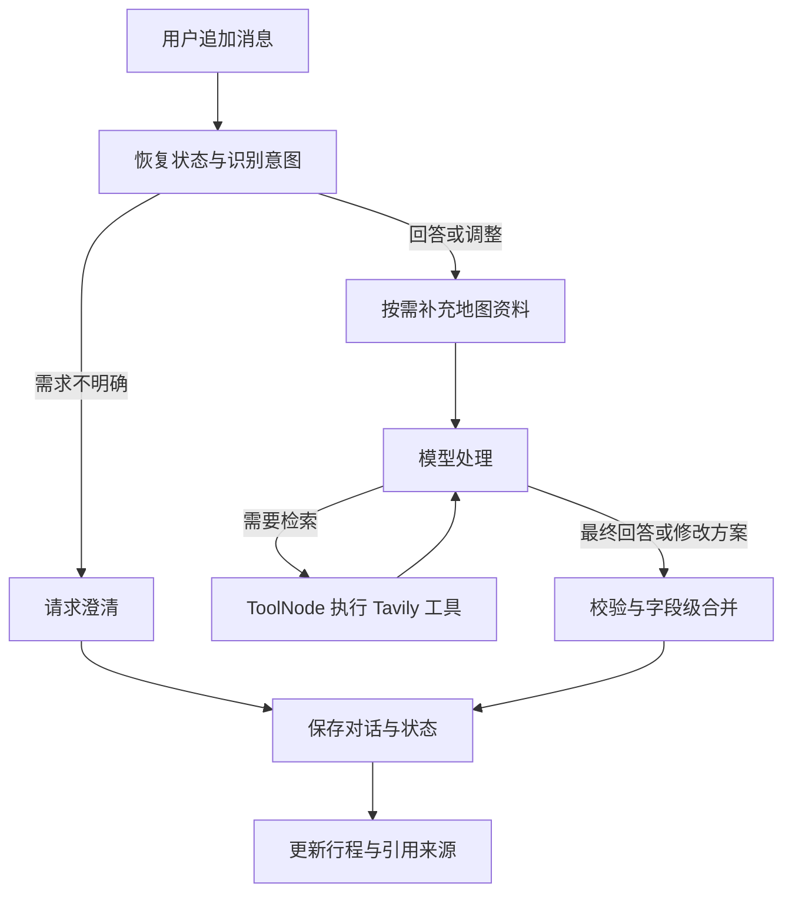

# Travel Agent · 基于高德地图 MCP 的智能旅行规划 Agent

根据目的地、出行日期与个人偏好生成旅行方案，通过多轮对话持续调整行程，并联网查询景点开放时间和预约要求。


**地图资料查询 → 结构化行程生成 → 多轮需求补充 → 联网核实与局部调整**

[功能概览](#功能概览) · [架构与工作流](#架构与工作流) · [快速开始](#快速开始) · [使用示例](#使用示例) · [API](#api) · [测试](#测试) · [常见问题](#常见问题)

## 功能概览

| 功能 | 实现内容 |
| --- | --- |
| 个性化规划 | 根据城市、日期、交通与住宿偏好，生成每日景点、餐饮、酒店、天气与预算 |
| 地图工具集成 | 通过 MCP 查询高德景点、天气和酒店资料；调整景点时补充候选 POI 与详情 |
| 多轮会话 | 保存对话、需求约束与规划状态，支持历史恢复、需求追加、旧约束撤销与替换 |
| 局部行程修改 | 按指定日期和授权字段合并修改，保留其他日期及未要求改动的酒店、餐饮 |
| 联网检索 | 模型按需调用 Tavily，查询开放时间、预约规则和公告，展示来源链接与检索时间 |
| 可视化与导出 | 地图标记、天气和预算展示、Unsplash 配图、手动编辑、图片及 PDF 导出 |
| 输出校验 | JSON Schema 提示、Pydantic 解析与业务一致性校验，非空错误输出最多修复一次 |

## 架构与工作流

### 技术分工

| 层级 | 技术 | 职责 |
| --- | --- | --- |
| 前端 | Vue 3、TypeScript、Ant Design Vue、Vite | 需求表单、会话交互与结果展示 |
| API | FastAPI、Pydantic | 接口、输入校验与结构化数据模型 |
| 模型 | LangChain / langchain-openai | 接入 OpenAI 兼容模型，绑定联网工具 |
| 工作流 | LangGraph、ToolNode | 状态传递、条件路由、工具执行与结果处理 |
| 地图 | MCP Python SDK、高德 MCP、高德 JS API | 后端地图查询与浏览器地图展示 |
| 外部信息 | Tavily、Unsplash | 联网检索与景点配图 |
| 存储 | SQLite、LangGraph SQLite Checkpointer | 会话快照、工作流检查点与检索缓存 |

### 首次生成行程

首页通过 `POST /api/conversations` 创建会话，调用规划工作流并保存结果。



模型超时或返回空内容会直接终止；修复后仍不合格会返回明确错误，不保存占位行程。校验涵盖字段结构、城市、日期范围、天数与每日序号。

### 多轮对话与工具调用



- **记忆机制**：SQLite 保存完整可见历史、有效约束与当前行程；LangGraph 按会话 ID 保存检查点。模型上下文使用最近 12 条历史消息及持久化约束。
- **工具调用**：通过 `bind_tools()` 绑定联网工具，模型按需选择；每轮对话最多执行 3 轮工具调用。
- **写入保护**：同会话写入串行执行，使用 `expected_version` 防止旧页面覆盖新结果。
- **预算更新**：修改后重算门票、酒店与餐饮费用，交通费用沿用已有估算。

## 快速开始

以下以 **Windows PowerShell、Python 3.11 与 uv** 为例，另需安装 Node.js 和 npm。模型服务须支持 OpenAI 兼容接口，多轮对话还需要支持工具调用（`tool_calls`）。

### 1. 克隆与安装

```powershell
git clone https://github.com/kikko00/travel_agent.git
cd travel_agent

uv python install 3.11
uv venv --python 3.11 .venv
uv pip install --python .\.venv\Scripts\python.exe -r .\backend\requirements.txt requests
```

后端通过 `requirements.txt` 管理依赖，由 uv 创建环境并安装。无需激活 Conda 或 `.venv`。

### 2. 创建配置文件

```powershell
if (!(Test-Path .\backend\.env)) {
    Copy-Item .\backend\.env.example .\backend\.env
}
if (!(Test-Path .\frontend\.env)) {
    Copy-Item .\frontend\.env.example .\frontend\.env
}
```

编辑 `backend/.env`：

```dotenv
# 必填：高德 Web 服务类型 Key
AMAP_API_KEY=your-amap-web-service-key

# 必填：OpenAI 兼容模型服务
LLM_API_KEY=your-model-api-key
LLM_BASE_URL=https://your-model-provider.example/v1
LLM_MODEL_ID=your-model-name
LLM_TIMEOUT=120
LLM_MAX_RETRIES=0

# 联网检索功能需要
TAVILY_API_KEY=your-tavily-api-key

# 景点配图功能需要；未配置时使用占位图
UNSPLASH_ACCESS_KEY=your-unsplash-access-key
```

编辑 `frontend/.env`：

```dotenv
VITE_API_BASE_URL=http://localhost:8000
VITE_AMAP_WEB_JS_KEY=your-amap-javascript-api-key
```

| 配置 | 获取与用途 |
| --- | --- |
| `AMAP_API_KEY` | [高德控制台](https://console.amap.com/)申请 **Web 服务** Key，供后端查询使用 |
| `VITE_AMAP_WEB_JS_KEY` | 高德控制台申请 **JavaScript API** Key，供页面地图使用；与后端 Key 分开配置 |
| `LLM_*` | 填写所选模型提供商的密钥、接口地址和模型名称 |
| `TAVILY_API_KEY` | [Tavily](https://app.tavily.com/)获取，用于联网检索 |
| `UNSPLASH_ACCESS_KEY` | [Unsplash Developers](https://unsplash.com/developers)创建应用获取 Access Key，用于图片搜索 |

`.env`、数据库、虚拟环境和构建产物已加入 Git 忽略。不要将真实密钥填写到 `.env.example`。

### 3. 启动后端

在项目根目录执行：

```powershell
cd backend
..\.venv\Scripts\python.exe -X utf8 run.py
```

从 `backend` 目录启动以正确读取 `.env`；`-X utf8` 避免部分 Windows 终端打印中文或 emoji 时编码失败。

### 4. 启动前端

另开终端，进入项目根目录：

```powershell
cd frontend
npm ci
npm run dev
```

| 入口 | 地址 |
| --- | --- |
| 应用页面 | [localhost:5173](http://localhost:5173/) |
| API 文档 | [localhost:8000/docs](http://localhost:8000/docs) |
| 健康检查 | [localhost:8000/health](http://localhost:8000/health) |

按 **Ctrl+C** 停止对应服务。修改后端 `.env` 后需重启后端。

## 使用示例

1. **生成行程**：填写“杭州、三日游、公共交通、经济型酒店、自然风光”等需求。
2. **追加需求**：“记住我不喜欢爬山，后续安排轻松一点。”
3. **局部调整**：“第二天换成博物馆，其他日期和酒店保持不变。”
4. **联网查询**：“浙江省博物馆几点开放，需要预约吗？只回答，不修改行程。”
5. **更新约束**：“撤销不要爬山的要求，可以安排轻度徒步。”
6. **恢复历史**：首页点击“查看历史会话”，或在结果页选择历史记录；刷新页面、重启后端后仍可恢复。

旧版仅保存在浏览器中的行程，可点击“将当前行程保存为会话”迁移。手动编辑时先保存或取消，再继续对话。

## 项目结构

```text
travel_agent/
├── backend/
│   ├── app/
│   │   ├── api/routes/           # 旅行、会话、地图与图片接口
│   │   ├── graphs/
│   │   │   ├── trip_graph.py     # 首次规划、校验与一次修复
│   │   │   └── conversation_graph.py  # 意图识别、工具调用与局部合并
│   │   ├── models/              # 请求、行程及对话模型
│   │   ├── services/
│   │   │   ├── amap_mcp.py       # 官方 MCP SDK 连接适配
│   │   │   ├── amap_service.py   # 高德服务入口
│   │   │   ├── conversation_service.py  # 会话生命周期与版本管理
│   │   │   ├── conversation_store.py    # SQLite 会话快照
│   │   │   ├── web_search_service.py    # Tavily 工具与缓存
│   │   │   └── unsplash_service.py      # 图片搜索
│   │   ├── agents/              # HelloAgents 参考实现
│   │   └── config.py
│   ├── tests/                   # 离线回归与 API 测试
│   ├── data/                    # 运行数据，不纳入版本控制
│   ├── test_amap_api.py          # 高德 Web API 联调
│   ├── test_amap_mcp.py          # 高德 MCP 联调
│   ├── requirements.txt
│   └── run.py
├── frontend/src/
│   ├── components/ChatPanel.vue  # 对话、历史会话与来源展示
│   ├── views/                   # Home.vue、Result.vue
│   ├── services/api.ts
│   └── types/
├── LANGGRAPH_REWRITE.md
└── README.md
```

## API

| 方法 | 路径 | 说明 |
| --- | --- | --- |
| `POST` | `/api/conversations` | 生成行程并创建会话，也可迁移已有行程 |
| `GET` | `/api/conversations` | 查询最近创建的 100 个会话 |
| `GET` | `/api/conversations/{id}` | 恢复消息、约束、版本与行程 |
| `POST` | `/api/conversations/{id}/messages` | 追加需求，回答问题或调整行程 |
| `PATCH` | `/api/conversations/{id}/plan` | 同步手动编辑并核算预算 |
| `POST` | `/api/trip/plan` | 保留的单次规划接口，不创建会话 |
| `GET` | `/api/poi/photo` | 按景点名称获取配图 URL |
| `GET` | `/health` | 服务进程健康检查 |

追加消息示例：

```json
{
  "content": "第二天换成博物馆，保留原酒店",
  "expected_version": 1
}
```

使用服务端返回的最新 `version` 作为下次写入的 `expected_version`。

| 状态码 | 含义 |
| --- | --- |
| `409` | 会话版本冲突，重新载入最新行程后重试 |
| `422` | 输入无效，例如日期范围与旅行天数不一致 |
| `502` | 上游调用失败，或模型输出在修复后仍不合格 |
| `504` | 模型或外部服务响应超时 |

## 测试

### 离线回归

从项目根目录执行；需要已安装依赖，不需要真实 API Key 或联网调用：

```powershell
cd backend
..\.venv\Scripts\python.exe -X utf8 -m unittest discover -s tests -p "test_*.py"
```

覆盖 MCP 会话清理、历史恢复、会话隔离、版本冲突、工具引用、局部修改保护、约束撤销、模型超时与输出修复。

### 真实高德联调

在项目根目录执行，需要有效的 Web 服务 Key 和网络：

```powershell
# 绕过 MCP，检查地理编码、景点搜索和天气
.\.venv\Scripts\python.exe -X utf8 backend\test_amap_api.py --city 杭州 --keyword 西湖

# 检查 MCP 工具发现与实际查询
.\.venv\Scripts\python.exe -X utf8 backend\test_amap_mcp.py
```

### 前端构建

```powershell
cd frontend
npm run build
```

构建会先执行 `vue-tsc` 类型检查，再生成 `frontend/dist/`。

## 常见问题

### 高德返回 `10009 / USERKEY_PLAT_NOMATCH`

后端 `AMAP_API_KEY` 必须使用 **Web 服务** 类型 Key。前端 JavaScript API Key 不能用于这些后端接口。

### MCP 需要手动安装或单独启动吗？

后端通过以下命令自动启动独立子进程，首次运行需要下载依赖：

```text
uvx --with pydantic==2.10.6 amap-mcp-server==0.1.11
```

该高德服务依赖旧版 MCP，因此只在 **uvx 独立环境** 固定兼容的 Pydantic，后端主环境使用自己的依赖。请确保 `uvx` 在 PATH 中，且 uv 缓存目录可读写。

出现工具数量为 0 或连接失败时，先运行 MCP 联调脚本查看实际原因。当前适配器会在关闭事件循环前退出会话和子进程。

### 生成行程超时

`LLM_TIMEOUT` 默认 120 秒，控制每次模型读取等待；连接超时为 10 秒。`LLM_MAX_RETRIES` 默认 0，避免隐式重复等待。前端等待上限为 10 分钟，涵盖地图查询与必要的输出修复。

日志中的 `[trip:请求编号]` 标记生成或修复阶段，记录提示词长度与耗时。超时直接返回 `504`，不会触发空输出修复。延长等待不能保证模型服务可用，仍需检查服务状态或缩短旅行天数。

### 图片显示占位图，或 Unsplash 返回 401

检查 `UNSPLASH_ACCESS_KEY`，保存后重启后端。搜索公开图片使用 Access Key，当前流程不需要 Secret Key。按名称搜索得到的图片可能不完全匹配实际景点。

### 联网检索没有结果

检查 `TAVILY_API_KEY`、网络和模型的工具调用支持。当前工具读取搜索摘要并展示来源，检索失败时开放与预约规则应视为待核实。成功检索按查询条件缓存一小时。

### 数据保存在哪里？

默认位于 `backend/data/`，会话快照、工作流检查点和检索缓存分别使用 SQLite 文件。可通过 `CONVERSATION_DATA_DIR` 修改目录。保留该目录即可保留会话数据；备份时应先停止后端。

## 当前边界

- 面向本地单用户、单后端实例，尚未加入账户鉴权；历史接口可读取本实例的全部会话，不宜直接暴露到公网。
- 地图连线展示景点顺序，尚未实现真实道路导航或最优路径计算；部分独立 `/api/map` 接口的数据解析仍需完善。
- 票价、酒店价格与交通预算包含估算，不能作为实时价格承诺；开放时间和预约规则以官方最新公告为准。
- 行程调整保持目的地与日期范围；更换城市或旅行日期时应创建新会话。

## 项目来源与许可

本项目基于 [Tripya/travel_agent](https://github.com/Tripya/travel_agent) 进行学习与扩展，新增多轮会话、状态持久化、联网检索和相关交互，并改进 MCP 连接管理与模型错误处理。原 HelloAgents 实现保留作学习参考，当前主流程使用 LangGraph。

沿用原项目 README 标注的 **CC BY-NC-SA 4.0**。使用和分发请遵守该许可及相关服务的使用条款。
